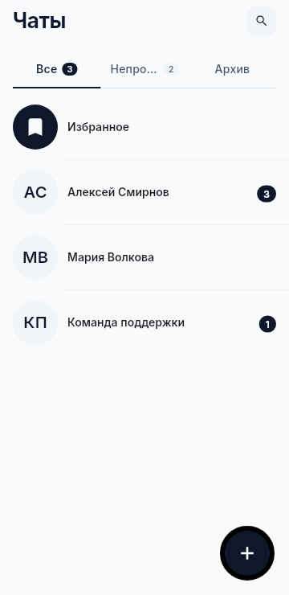
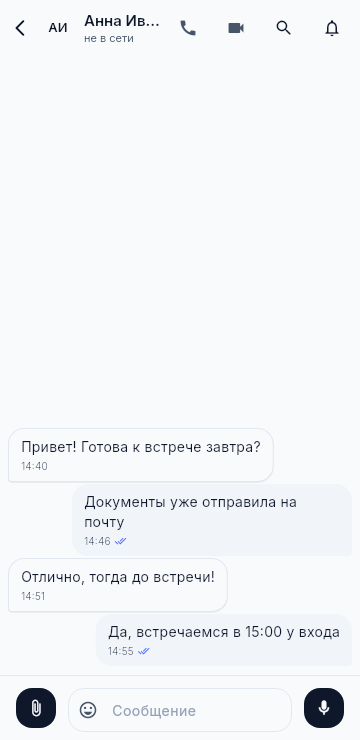
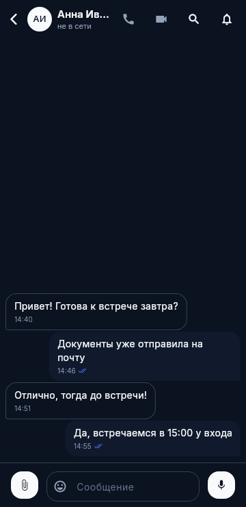
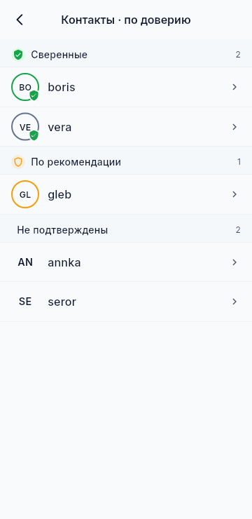
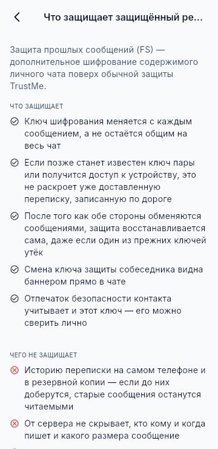
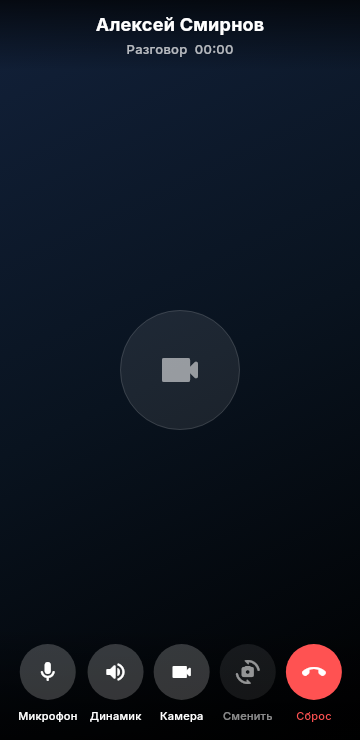

<p align="center">
  
</p>

<h1 align="center">TrustMe</h1>

<p align="center">
  <b>An end-to-end encrypted messenger with a trust network.</b><br>
  No phone number or email. Your account key is created and kept on your device.
</p>

<p align="center">
  <a href="https://github.com/Darkildo/TrustMe-releases/releases/latest"></a>
  
  <a href="README.md"></a>
</p>

---

This repository holds **ready-made builds and a description of the app**. There is no source code here.
Every version is published under [Releases](https://github.com/Darkildo/TrustMe-releases/releases) with files for all platforms and their checksums.

## Download

| Platform | File | Requirements |
| --- | --- | --- |
| **Android** (most phones) | [TrustMe-android-arm64-v8a.apk](https://github.com/Darkildo/TrustMe-releases/releases/latest/download/TrustMe-android-arm64-v8a.apk) | Android 10+ |
| Android, older 32-bit devices | [TrustMe-android-armeabi-v7a.apk](https://github.com/Darkildo/TrustMe-releases/releases/latest/download/TrustMe-android-armeabi-v7a.apk) | Android 10+ |
| Android, not sure which | [TrustMe-android-universal.apk](https://github.com/Darkildo/TrustMe-releases/releases/latest/download/TrustMe-android-universal.apk) | Android 10+, larger file |
| **Windows** | [TrustMe-windows-x64.zip](https://github.com/Darkildo/TrustMe-releases/releases/latest/download/TrustMe-windows-x64.zip) | Windows 10 (19041+) or 11, x64 |
| **Linux** — Ubuntu, Debian, Mint | [TrustMe-linux-x64.deb](https://github.com/Darkildo/TrustMe-releases/releases/latest/download/TrustMe-linux-x64.deb) | Ubuntu 24.04+, Debian 13, Mint 22 |
| Linux — portable | [TrustMe-linux-x64.tar.gz](https://github.com/Darkildo/TrustMe-releases/releases/latest/download/TrustMe-linux-x64.tar.gz) | glibc 2.38+ (incl. Fedora 40+) |
| **iOS** | TestFlight, by invitation | iOS 15.6+ |

The links above always point to the latest version. Older versions and change notes are in [Releases](https://github.com/Darkildo/TrustMe-releases/releases).
There are no macOS or web builds.

## Screenshots

The app UI is in Russian on these screenshots; English is available in settings.

<p align="center">
  
  
  
  
</p>
<p align="center">
  
  
  
  
</p>

## Features

### An account without a phone number
- The account is created on your device: you swipe across the screen, and that randomness generates your Ed25519 key. Its public part is your identifier.
- No phone number or email required. You may add a phone number; only confirmed contacts will see it.
- Add contacts by QR code or by an invitation code with an expiry, including one-time codes.

### Trust network
- Compare a contact's key fingerprint in person and mark them as verified.
- Contacts are grouped into verified, recommended by mutual contacts, and unconfirmed.
- If a contact's key changes, a warning appears in the chat.
- Grant and revoke per-contact permissions: messages, calls, contacts, location history, device info.

### Messaging
- Replies, reactions, editing, delete for me or for everyone, pinned messages.
- Formatting: bold, italic, strikethrough, monospace, spoiler.
- Photos, videos and files (up to 10 at once), albums, view-once media, built-in photo editor.
- Voice messages up to 10 minutes and round video messages.
- Polls: multiple choice, anonymous, auto-close.
- Stickers: your own packs, archive import, sharing packs in chats.
- Disappearing messages, from one hour to four weeks.
- Search in a chat and across chats, archive, pinning, drafts, Saved Messages.
- Read receipts and online status, configurable per contact.
- Live typing: your contact sees the text as you type it — only if you both turn it on.

### Groups
- Owner and admin roles, admins-only posting mode.
- New members see either only new messages or the full history — chosen when the group is created.
- @-mentions.

### Calls
- One-to-one audio and video calls with end-to-end encryption.
- Group calls: up to 5 people for audio and up to 3 for video.
- Screen sharing from a computer (Windows and Linux), optionally with system audio. Phones can watch a shared screen.
- Noise suppression, including on-device AI mode.
- Full-screen incoming calls on Android, CallKit on iOS.

### Location
- Share your live location with chosen contacts for 15 minutes, 1 hour, 8 hours, or until you stop.
- Location history with stops and tracks — visible only to contacts you grant that permission. GPX export.

### On the desktop
- Two-pane layout, tray icon, keyboard shortcuts, drag and drop, launch at startup.
- Light, dark and system themes. Russian and English.

## Security and privacy

**Encryption.** Messages, media, location and profile data are encrypted on your device and decrypted only by the recipient:
X25519 key agreement, AES-256-GCM encryption, Ed25519 signatures. Calls use DTLS-SRTP, with signalling over the same encrypted channel.
The connection to the server is additionally protected by the Noise protocol.

**Forward secrecy.** In a direct chat you can turn on an extra Double Ratchet layer: the key changes with every message,
so a leaked key or a stolen device cannot reveal messages already delivered. It is enabled per chat and only with both sides' consent.
It does not cover groups or calls.

**On the device.**
- Unlock with an 8-digit PIN or a password, plus Face ID, Touch ID or fingerprint.
- Auto-lock after a chosen period; optionally wipe data after 10 failed attempts.
- The local database is encrypted (SQLCipher); the key file uses Argon2id + AES-256-GCM.
- Optional on-device media encryption, with the key bound to the device's secure storage.
- On Android, screenshots are blocked; the app switcher preview is hidden on both mobile platforms.

**Notifications.** The server sends only a wake-up signal, never the content. Your device fetches and decrypts the message and shows the notification itself.

**What the server sees.** The server cannot read message content. It does know who writes to whom, when, and how large each message is, and the shape of your contact graph.
Undelivered messages are kept on the server, encrypted, for up to 14 days.

**Your own server.** In settings you can point the app at a different node — host, port and its key — and verify the node's fingerprint.

**GIFs and link previews.** GIF search goes through Tenor, so Google sees the query and your IP address. The feature is optional.
Link previews are fetched by the sender's device.

## Backup and transfer

- **Transfer to a new device.** The new device shows a QR code, the old one sends an encrypted file. Keys, contacts and groups move over; no server is involved.
- **Backup** — an encrypted archive protected by a password of at least 12 characters. Restoring from it creates a **new account**: exchange QR codes with your contacts again.
- The backup stays inside the app until you export it. Without a transfer or a backup, losing your device means losing your keys and messages.

## Installation

<details>
<summary><b>Android</b></summary>

1. Download the APK. `arm64-v8a` fits nearly every recent phone; if unsure, take `universal`.
2. Open the file and allow installs from this source when asked.
3. To update, install the new APK over the old one. Messages and keys are kept.

</details>

<details>
<summary><b>Windows</b></summary>

1. Download the zip. Before extracting: right-click → Properties → Unblock (if the checkbox is there).
2. Extract anywhere and run `TrustMe.exe`. There is no installer.
3. The build is not code-signed, so SmartScreen will warn you: More info → Run anyway.
4. To update, replace the whole folder. Data lives separately in `%APPDATA%\com.requiem\TrustMe` and is kept.

Closing the window minimises it to the tray; quit from the tray icon menu. There are no push notifications on desktop: messages arrive while the app is running.
If you see "No connection" with `os error 10013`, allow `TrustMe.exe` network access in your firewall or antivirus.

</details>

<details>
<summary><b>Linux</b></summary>

**.deb** (Ubuntu 24.04+, Debian 13, Mint 22) — dependencies are installed automatically:

```sh
sudo apt install ./TrustMe-linux-x64.deb
```

**.tar.gz** (any distribution with glibc 2.38+, including Fedora 40+) — extract and run `./TrustMe`.
Install the system libraries yourself:

```sh
# Debian / Ubuntu / Mint
sudo apt install libgtk-3-0t64 libmpv2 libepoxy0 libsecret-1-0 \
     libayatana-appindicator3-1 libpulse0 pulseaudio-utils ffmpeg gnome-keyring
# Fedora
sudo dnf install gtk3 mpv-libs libepoxy libsecret \
     libayatana-appindicator-gtk3 pulseaudio-libs pulseaudio-utils ffmpeg-free gnome-keyring
```

- Keys are stored in the system secret store. Without a running gnome-keyring or KWallet the app will not start and will explain why.
- Screen sharing on Wayland needs xdg-desktop-portal and PipeWire; on X11 it works out of the box.
- Data lives in `~/.local/share/com.requiem.trust_me`; to update the portable build, replace the folder.
- It will not run on Ubuntu 22.04 or other distributions with an older glibc.

</details>

<details>
<summary><b>iOS</b></summary>

iPhone builds are distributed via TestFlight by invitation. iOS 15.6 or later is required.

</details>

## Verifying downloads

Each release includes `SHA256SUMS-android.txt`, `SHA256SUMS-windows.txt` and `SHA256SUMS-linux.txt`.
Compare the checksum of your download with the matching line:

```sh
sha256sum TrustMe-android-arm64-v8a.apk          # Linux
shasum -a 256 TrustMe-android-arm64-v8a.apk      # macOS
```
```powershell
Get-FileHash TrustMe-windows-x64.zip -Algorithm SHA256   # Windows
```

All Android APKs are signed with the same key. If Android refuses to install an update over the installed version, the file was signed with a different key — do not install it.

## Known limitations

- One account, one device. There is no simultaneous multi-device sync; account transfer is available.
- Only received media can be forwarded: text cannot be forwarded, and nothing can be forwarded to groups.
- No push notifications on Windows or Linux.
- No camera video or round video messages on Linux; Windows has both.
- Desktop updates are installed manually.
- Disappearing messages are deleted by the recipient's app; nothing can guarantee the recipient did not save them another way.

## Reporting a problem

Open an [issue](https://github.com/Darkildo/TrustMe-releases/issues/new/choose) with the app version, your device and the steps that lead to the problem.

> [!WARNING]
> Do not attach diagnostics exports, backups, transfer files or screenshots of conversations — issues are public.
> If logs are needed, you will be asked separately.

Report vulnerabilities privately, not in issues — see [SECURITY.md](SECURITY.md).

## License

The app is distributed free of charge as ready-made builds. The source code is not published; all rights reserved by the copyright holder.
For commercial use inquiries: didakostya@gmail.com.
