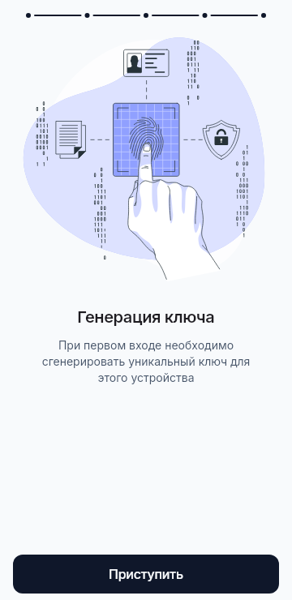
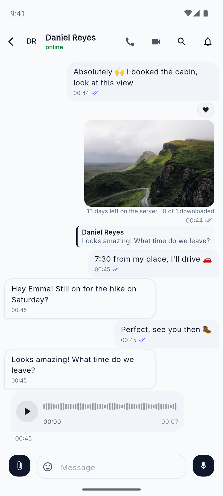
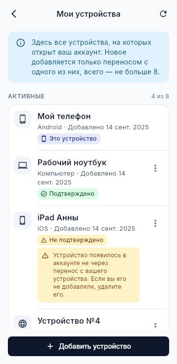
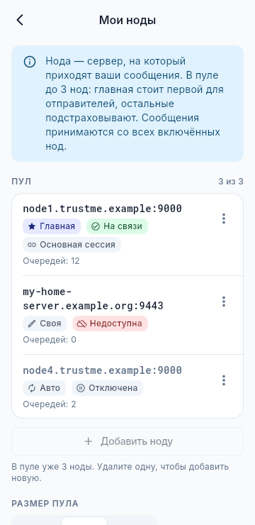
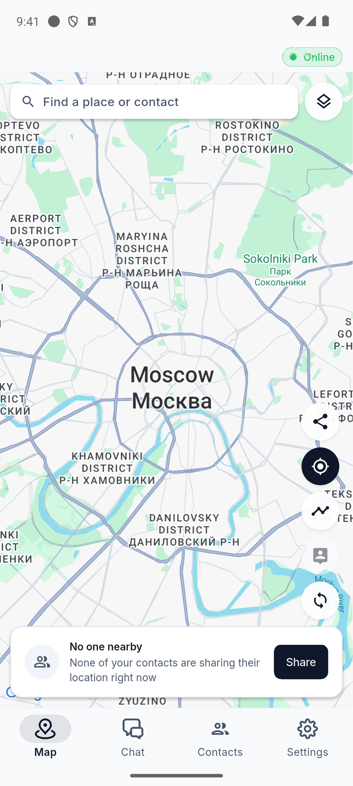
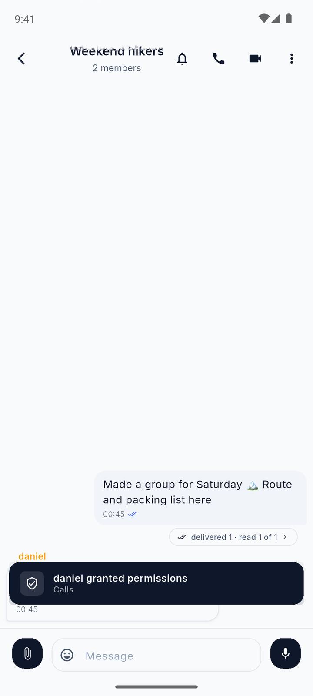
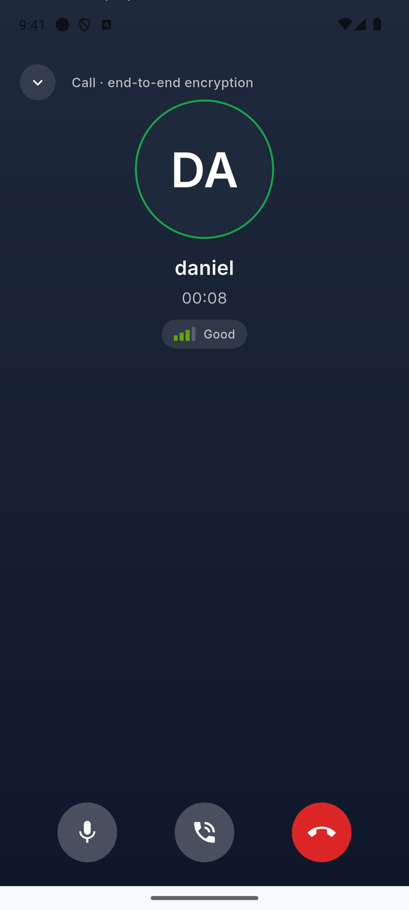
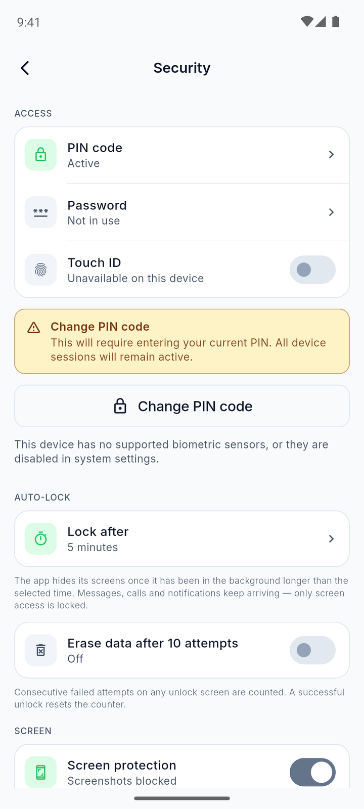
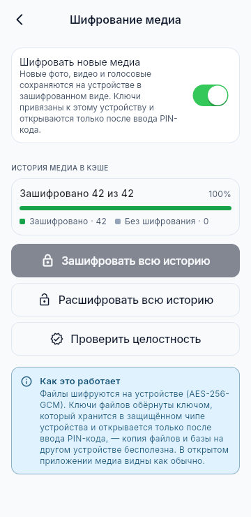

<p align="center">
  
</p>

<h1 align="center">TrustMe</h1>

<p align="center">
  <b>Приватный мессенджер с открытым сервером и сетью доверия.</b><br>
  Без номера телефона. Ваш аккаунт - это ключ, который живёт только на вашем устройстве.
</p>

<p align="center">
  <a href="https://github.com/Darkildo/TrustMe-releases/releases/latest"></a>
  
  <a href="https://github.com/Darkildo/trustme_backend"></a>
  <a href="README.en.md"></a>
</p>

---

TrustMe - мессенджер для тех, кто хочет общаться свободно и не отдавать переписку никому, включая владельца сервера.
Пишите, звоните, делитесь фото и местоположением, собирайтесь в группы - всё шифруется прямо на вашем устройстве.
А если не хотите зависеть даже от нашего сервера, поднимите свой: его код открыт.

## Скачать

| Платформа | Файл | Требования |
| --- | --- | --- |
| **Android** (большинство телефонов) | [TrustMe-android-arm64-v8a.apk](https://github.com/Darkildo/TrustMe-releases/releases/latest/download/TrustMe-android-arm64-v8a.apk) | Android 10+ |
| Android, старые 32-битные устройства | [TrustMe-android-armeabi-v7a.apk](https://github.com/Darkildo/TrustMe-releases/releases/latest/download/TrustMe-android-armeabi-v7a.apk) | Android 10+ |
| Android, не знаете какой | [TrustMe-android-universal.apk](https://github.com/Darkildo/TrustMe-releases/releases/latest/download/TrustMe-android-universal.apk) | Android 10+, файл больше |
| **Windows** | [TrustMe-windows-x64.zip](https://github.com/Darkildo/TrustMe-releases/releases/latest/download/TrustMe-windows-x64.zip) | Windows 10 (19041+) или 11, x64 |
| **Linux**: Ubuntu, Debian, Mint | [TrustMe-linux-x64.deb](https://github.com/Darkildo/TrustMe-releases/releases/latest/download/TrustMe-linux-x64.deb) | Ubuntu 24.04+, Debian 13, Mint 22 |
| Linux, портативная | [TrustMe-linux-x64.tar.gz](https://github.com/Darkildo/TrustMe-releases/releases/latest/download/TrustMe-linux-x64.tar.gz) | glibc 2.38+, в т. ч. Fedora 40+ |
| **iOS** | через TestFlight по приглашению | iOS 15.6+ |

Ссылки всегда ведут на последнюю версию. Прошлые версии и список изменений - в [Releases](https://github.com/Darkildo/TrustMe-releases/releases).

<table>
  <tr>
    <td align="center" width="20%"><br><sub>Ключ аккаунта создаётся на устройстве</sub></td>
    <td align="center" width="20%"><br><sub>Переписка со сквозным шифрованием</sub></td>
    <td align="center" width="20%"><br><sub>Видно, кому можно доверять</sub></td>
    <td align="center" width="20%"><br><sub>Один аккаунт на 8 устройствах</sub></td>
    <td align="center" width="20%"><br><sub>Пул нод и строгий режим</sub></td>
  </tr>
  <tr>
    <td align="center" width="20%"><br><sub>Местоположение: кому и на сколько, решаете вы</sub></td>
    <td align="center" width="20%"><br><sub>Группы с ролями и исчезающими сообщениями</sub></td>
    <td align="center" width="20%"><br><sub>Звонки защищены DTLS-SRTP</sub></td>
    <td align="center" width="20%"><br><sub>PIN, биометрия и автоблокировка</sub></td>
    <td align="center" width="20%"><br><sub>Фото и видео зашифрованы и на телефоне</sub></td>
  </tr>
</table>

## Последние изменения

- **13.0**, октябрь 2026: файлы хранятся на вашей ноде и скачиваются по вашим правилам, настройки автозагрузки и срока хранения, отзыв файла у всех, ретрансляция звонков с временными учётками от ноды.
- **12.1**: новые экраны «Мои устройства», «Мои ноды» и переноса аккаунта по шагам.
- **12.0**: до 8 устройств в одном аккаунте, пул нод и строгий режим.
- **11.8**: перенос аккаунта с подтверждением кодом, удаление чужих сообщений администраторами групп.

Подробности по каждой версии: [Releases](https://github.com/Darkildo/TrustMe-releases/releases).

## Почему TrustMe

### Никаких номеров и почты
Чтобы завести аккаунт, достаточно провести пальцем по экрану: из этого движения на устройстве рождается ваш ключ.
Не нужно сообщать номер телефона, почту или настоящее имя - а значит, им и неоткуда утечь. Друзей вы добавляете по QR-коду или коду приглашения.

### Переписку не прочитает никто, кроме собеседника
Сообщения, фото, голосовые, звонки и геолокация шифруются на вашем устройстве и расшифровываются только у получателя.
Сервер лишь передаёт зашифрованные конверты. Для особо важных разговоров включите защиту прошлых сообщений:
ключ меняется с каждым сообщением, и даже украденный телефон не раскроет то, что уже доставлено.

### Вы знаете, с кем говорите
Сверьте отпечаток ключа при встрече, и контакт получит отметку «Сверен». Знакомые могут порекомендовать вам друг друга,
а приложение предупредит, если ключ собеседника вдруг сменился. Каждому контакту вы сами выдаёте права:
кто может звонить, видеть ваше местоположение или историю перемещений.

### Ваш сервер - ваши правила
Пользуйтесь общим сервером или поднимите свой: для себя, семьи или команды.
[Код сервера открыт](https://github.com/Darkildo/trustme_backend): нода запускается в Docker одной командой,
а в приложении достаточно указать её адрес и ключ. Нод может быть до трёх: главная принимает ваши сообщения,
остальные подстраховывают её. Строгий режим закрывает ваш ящик для всех, кому вы не выдавали очередь.

### Все ваши устройства
Один аккаунт работает на телефоне, планшете и компьютере одновременно: до 8 устройств.
Новое добавляется переносом с любого из уже подключённых и подтверждается кодом, без логинов и паролей.
Контакты, чаты, переписка, группы, медиа и настройки синхронизируются между устройствами по тому же сквозному шифрованию.

### Всё, к чему вы привыкли
Это не аскетичный «защищённый чат», а полноценный мессенджер: реакции, ответы, стикеры, голосовые и видеосообщения-«кружки»,
опросы, группы, видеозвонки и показ экрана с компьютера.

## Что можно делать

**Общаться как удобно.** Отвечайте на конкретные сообщения, ставьте реакции, пересылайте в другие чаты, редактируйте и удаляйте отправленное у себя или у всех.
Записывайте голосовые до 10 минут и «кружки», отправляйте пачку фото и видео одним альбомом, подправьте снимок во встроенном редакторе.
Секретное фото можно отправить на один просмотр, а переписку настроить на автоудаление через час, день или неделю.

**Выражать себя.** Собирайте свои стикерпаки, импортируйте их из архива и делитесь ими прямо в чате.
Выделяйте текст жирным, курсивом или прячьте под спойлер. Включите «живой набор», и собеседник увидит ответ по мере того, как вы его печатаете
(только если вы оба этого хотите).

**Делиться файлами.** Фото, видео и документы загружаются на вашу ноду одним зашифрованным файлом, собеседник получает лишь указатель и скачивает его сам.
Вы выбираете, что скачивать автоматически в Wi-Fi, мобильной сети и роуминге, и сколько дней файл хранится на ноде.
Свой файл можно отозвать у всех, а истёкший собеседник попросит заново одним нажатием.

**Созваниваться.** Аудио- и видеозвонки один на один и в группе: до 5 человек голосом и до 3 по видео.
Показывайте экран с компьютера вместе со звуком, чтобы помочь с настройкой или обсудить документ.
Шумоподавление на устройстве убирает фоновый шум, а на телефоне входящий звонок приходит на весь экран, как обычный.

**Встречаться.** Поделитесь местоположением с близкими на 15 минут, час, 8 часов или пока не выключите.
Тем, кому доверяете, можно открыть историю перемещений с остановками и маршрутами и выгрузить её в GPX.

**Работать вместе.** Создавайте группы с администраторами и режимом «пишут только админы», упоминайте участников через @,
проводите опросы с анонимным голосованием и автозакрытием. Владелец и администраторы могут удалить чужое сообщение у всех.
Новые участники видят либо только новые сообщения, либо всю историю: это решается при создании группы.

**Держать порядок.** Ищите по чату и по всем чатам сразу, закрепляйте важное, убирайте лишнее в архив,
сохраняйте заметки себе в «Избранное». Отчёты о прочтении и статус «в сети» настраиваются для каждого контакта отдельно.

**Работать за компьютером.** Версии для Windows и Linux с двухпанельным интерфейсом, значком в трее, горячими клавишами
и перетаскиванием файлов. Светлая и тёмная тема, русский и английский язык.

## Открытость

- **Сервер.** [Исходный код](https://github.com/Darkildo/trustme_backend) открыт: в репозитории лежат протокол, схемы сообщений и инструкции по развёртыванию.
  Его можно изучить, собрать и поднять свою ноду; условия использования описаны в [LICENSING.md](https://github.com/Darkildo/trustme_backend/blob/master/LICENSING.md).
- **Протокол.** Формат обмена описан в [server-contract.md](https://github.com/Darkildo/trustme_backend/blob/master/server-contract.md)
  и [схемах protobuf](https://github.com/Darkildo/trustme_backend/tree/master/schemas). По коду можно убедиться, что сервер видит только зашифрованные конверты.
- **Клиент и криптографическое ядро** готовятся к публикации. Пока приложение распространяется готовыми сборками из этого репозитория.

## Безопасность и приватность

**Шифрование.** Сообщения, медиа, геолокация и профиль шифруются на вашем устройстве и расшифровываются только у собеседника:
обмен ключами X25519, шифрование AES-256-GCM, подписи Ed25519. Файлы шифруются на устройстве в один контейнер и загружаются на ноду, которая открыть его не может.
Звонки защищены DTLS-SRTP, их сигнализация идёт по тому же зашифрованному каналу; если прямое соединение невозможно,
звонок идёт через ретранслятор с временными учётками от ноды, поток остаётся зашифрованным.
Соединение с сервером дополнительно защищено протоколом Noise.

**Защита прошлых сообщений (Forward Secrecy).** В личном чате можно включить дополнительный слой на основе Double Ratchet: ключ меняется с каждым сообщением.
Включается для каждого чата отдельно и только с согласия обеих сторон. Группы и звонки этот слой не покрывает.

**Устройство.**
- Вход по PIN-коду (8 цифр) или паролю, плюс Face ID, Touch ID или отпечаток пальца.
- Автоблокировка через выбранное время; при желании стирание данных после 10 неудачных попыток.
- Локальная база зашифрована (SQLCipher), файл ключа защищён Argon2id и AES-256-GCM.
- Фото, видео и файлы хранятся на устройстве в зашифрованном виде (включено по умолчанию). Ключи открываются только после ввода PIN-кода или пароля.
- На Android приложение запрещает скриншоты, а в списке открытых приложений содержимое скрыто на обеих мобильных платформах.
- Между вашими устройствами данные ходят только в зашифрованном виде: сервер не отличает их от обычных сообщений.

**Уведомления.** Сервер присылает только сигнал «проснись», без текста. Устройство само получает и расшифровывает сообщение и показывает уведомление.

**Что видит сервер.** Содержимое сообщений сервер прочитать не может. Но ему известно, кто кому, когда и какого размера пишет, и ваш список контактов на уровне связей.
Недоставленные сообщения хранятся на сервере в зашифрованном виде до 14 дней. Файлы лежат на ноде столько, сколько вы выбрали при отправке
(по умолчанию 14 дней), и их можно отозвать раньше. Если для вас важно, кто держит эти данные, поднимите свой сервер.

**GIF и превью ссылок.** Поиск GIF работает через Tenor: Google увидит поисковый запрос и ваш IP-адрес. Функция необязательная.
Превью ссылки загружает устройство отправителя.

## Резервная копия и перенос

- **Перенос на новое устройство.** Новое устройство показывает QR-код и 4 цифры, старое передаёт зашифрованный файл и код подтверждения из 6 цифр,
  поэтому посторонний, увидевший QR, не подсунет чужой аккаунт. Переезжают ключи, контакты и группы, переписка и медиа догоняются с других устройств.
- **Несколько устройств.** Перенос не отключает старое устройство: оба остаются в аккаунте, всего до 8. Лишнее удаляется в «Мои устройства» и сразу выходит из аккаунта.
- **Резервная копия.** Это зашифрованный архив с паролем от 12 символов. Восстановление из неё создаёт **новый аккаунт**: обменяйтесь QR-кодами с контактами заново.
- Резервная копия хранится внутри приложения, пока вы её не экспортируете. Без переноса или копии потеря устройства означает потерю ключей и переписки.

## Установка

<details>
<summary><b>Android</b></summary>

1. Скачайте APK. Почти всем телефонам последних лет подходит `arm64-v8a`. Если не уверены, берите `universal`.
2. Откройте файл и разрешите установку из этого источника, когда система попросит.
3. Чтобы обновиться, установите новый APK поверх старого. Переписка и ключи сохранятся.

</details>

<details>
<summary><b>Windows</b></summary>

1. Скачайте zip. Перед распаковкой: правый клик → «Свойства» → «Разблокировать» (если галочка есть).
2. Распакуйте в любую папку и запустите `TrustMe.exe`. Установщика нет.
3. Сборка не подписана сертификатом, поэтому SmartScreen покажет предупреждение: «Подробнее» → «Выполнить в любом случае».
4. Чтобы обновиться, замените папку целиком. Данные лежат отдельно, в `%APPDATA%\com.requiem\TrustMe`, и сохранятся.

Крестик сворачивает окно в трей; выйти можно через меню значка в трее. Push-уведомлений на компьютере нет: сообщения приходят, пока приложение запущено.
Если приложение пишет «Нет соединения» с ошибкой `os error 10013`, разрешите `TrustMe.exe` доступ в сеть в брандмауэре или антивирусе.

</details>

<details>
<summary><b>Linux</b></summary>

**.deb** (Ubuntu 24.04+, Debian 13, Mint 22), зависимости подтянутся сами:

```sh
sudo apt install ./TrustMe-linux-x64.deb
```

**.tar.gz** (любой дистрибутив с glibc 2.38+, в том числе Fedora 40+): распакуйте и запустите `./TrustMe`.
Системные библиотеки поставьте сами:

```sh
# Debian / Ubuntu / Mint
sudo apt install libgtk-3-0t64 libmpv2 libepoxy0 libsecret-1-0 \
     libayatana-appindicator3-1 libpulse0 pulseaudio-utils ffmpeg gnome-keyring
# Fedora
sudo dnf install gtk3 mpv-libs libepoxy libsecret \
     libayatana-appindicator-gtk3 pulseaudio-libs pulseaudio-utils ffmpeg-free gnome-keyring
```

- Ключи хранятся в системном хранилище секретов. Без запущенного gnome-keyring или KWallet приложение не запустится и объяснит почему.
- Показ экрана на Wayland требует xdg-desktop-portal и PipeWire; на X11 работает сразу.
- Данные лежат в `~/.local/share/com.requiem.trust_me`. Чтобы обновить портативную сборку, замените папку.
- На Ubuntu 22.04 и других дистрибутивах со старой glibc сборка не запустится.

</details>

<details>
<summary><b>iOS</b></summary>

Сборки для iPhone распространяются через TestFlight по приглашению. Нужен iOS 15.6 или новее.

</details>

## Проверка подлинности файла

К каждому релизу приложены файлы `SHA256SUMS-android.txt`, `SHA256SUMS-windows.txt` и `SHA256SUMS-linux.txt`.
Сверьте сумму скачанного файла со строкой из списка:

```sh
sha256sum TrustMe-android-arm64-v8a.apk          # Linux
shasum -a 256 TrustMe-android-arm64-v8a.apk      # macOS
```
```powershell
Get-FileHash TrustMe-windows-x64.zip -Algorithm SHA256   # Windows
```

APK для Android подписаны одним ключом. Если система отказывается ставить обновление поверх установленной версии, значит, файл подписан не тем ключом: не устанавливайте его.

## Ограничения, о которых стоит знать

- Новое устройство добавляется в аккаунт только переносом с одного из уже подключённых: входа по логину и паролю нет.
- Версии 12 и новее несовместимы с 11.x, а файлами обмениваются только версии 13 и новее: обновляться нужно всем собеседникам и на всех своих устройствах.
- Фото «на один просмотр» переслать нельзя; свой файл пересылается, пока его копия есть на устройстве.
- Push-уведомлений на Windows и Linux нет.
- На Linux нет записи видео с камеры и «кружков»; на Windows они есть.
- Обновления на компьютере ставятся вручную.
- Исчезающие сообщения удаляются у собеседника его приложением; гарантировать, что он не сохранил их другим способом, нельзя.
- Сборок для macOS и веб-версии нет.

## Сообщить о проблеме

Создайте [issue](https://github.com/Darkildo/TrustMe-releases/issues/new/choose): укажите версию приложения, устройство и шаги, после которых возникла проблема.

> [!WARNING]
> Не прикладывайте к issue экспорт диагностики, резервные копии, файлы переноса и скриншоты с перепиской: issue видны всем.
> Если для разбора нужны логи, об этом спросят отдельно.

Об уязвимостях пишите не в issue, а по адресу из [SECURITY.md](SECURITY.md).

## Лицензия

Приложение бесплатно и распространяется готовыми сборками из этого репозитория. Код сервера открыт, условия описаны в его [LICENSING.md](https://github.com/Darkildo/trustme_backend/blob/master/LICENSING.md).
По остальным вопросам: didakostya@gmail.com.
